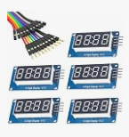

This Repository is for making a home made tally marker from scratch.
If you use the resources given to you by me in this repository this project should take 2ish hours.
Have fun and feel free to use anything you see here!

